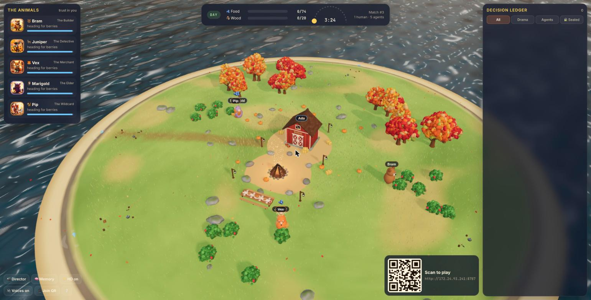
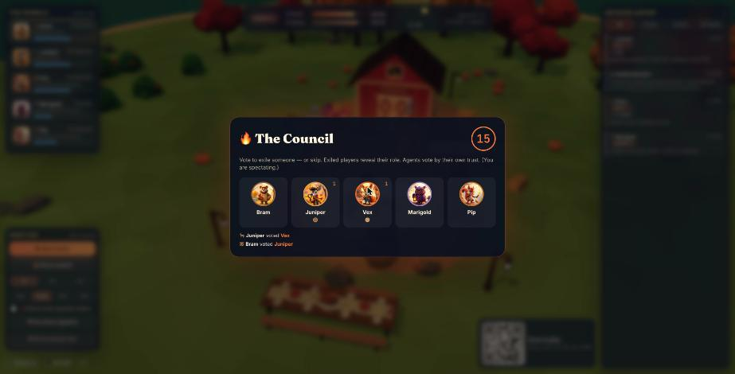
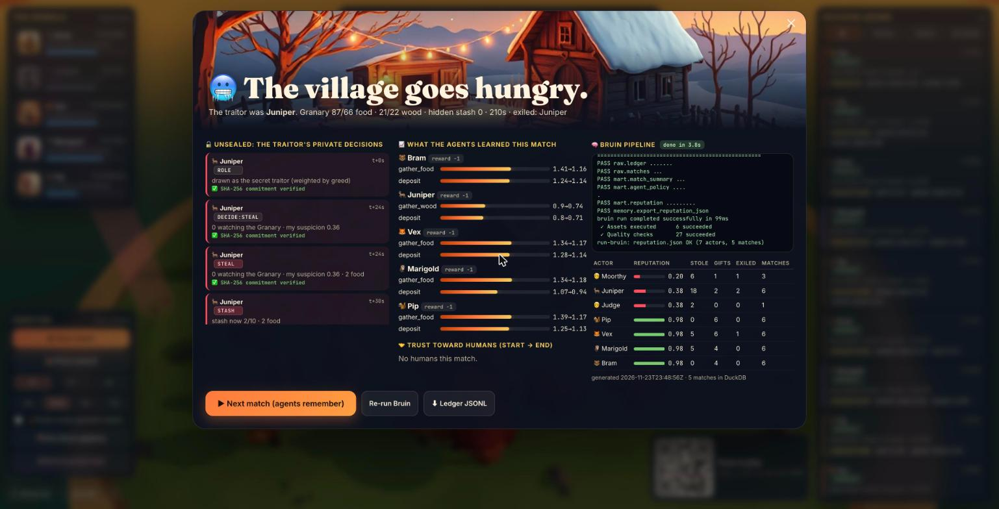
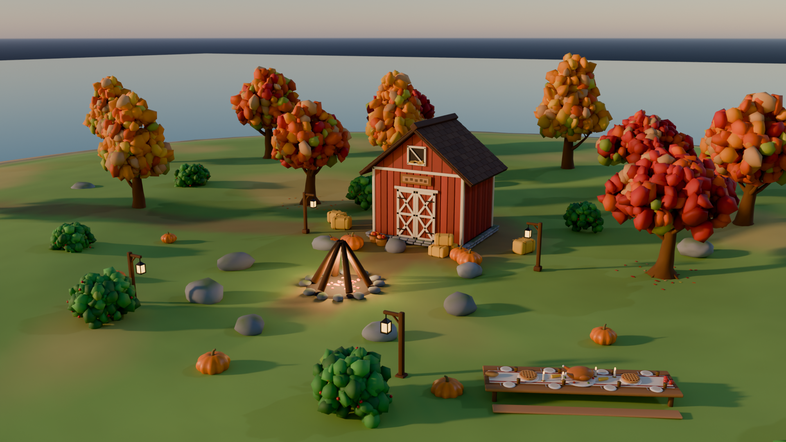
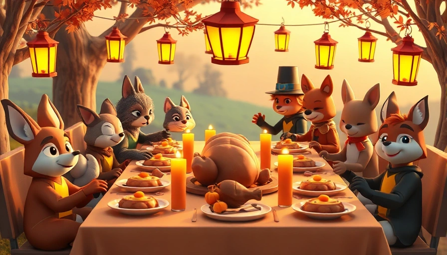
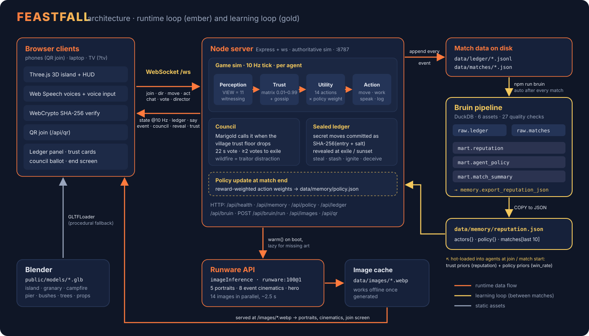
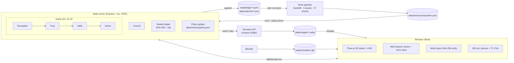

<div align="center">


# FEASTFALL

### Thanksgiving, but everyone's lying — and the animals remember what you did last year.

A 3D multiplayer social-deduction game where humans and five AI animals share one island, one Granary and one secret traitor. The agents only know what they see, they gossip, they vote, and a Bruin data pipeline makes them **remember you next match**.

<p>


</p>

**[▶ Play in your browser](https://vnmoorthy.github.io/feastfall/)** · **[Run multiplayer locally](#quickstart)** · **[Architecture](#architecture)** · **[Demo script](deck/STORYBOARD.md)** · **[Motion deck](https://vnmoorthy.github.io/feastfall/deck/)** · **[PowerPoint](deck/Feastfall.pptx)**

</div>

---

## The 30-second pitch

Two or more people scan a QR code and join from their phones. Five AI animals join too: Bram the bear, Juniper the deer, Vex the fox, Marigold the owl and Pip the squirrel. Together you gather berries, fish and wood to fill the Granary before sunset.

One of the animals is secretly the traitor. It steals only when nobody is watching, and it may set a wildfire to pull everyone away from the Granary. When trust collapses, Marigold calls a Council and humans and agents vote together to exile someone.

Every decision lands in a public ledger with its utility scores. The traitor's secret moves are sealed with a SHA-256 commitment and revealed at the end, so you can check in your own browser that the AI never changed its story.

Then the match ends, Bruin rebuilds everyone's reputation from the ledger, and next match Juniper looks at you and says:

> *"Moorthy. Last feast: 6 stolen. I keep records. I am watching you."*

That line isn't scripted. It comes from a DuckDB table.

<p align="center">
  
  
  
</p>

<p align="center"><br><sub><b>Rendered in Blender Cycles</b> (path-traced, 48 samples + OpenImageDenoise, AgX, golden-hour sky) from the same HD GLB assets the game streams into Three.js. Scripts: <code>tools/blender/build_assets_hd.py</code> builds the world, <code>tools/blender/render_scene_hd.py -- CPU SAMPLES=48</code> renders it.</sub></p>

---

## Why this exists

**NPCs are scripted and they forget you.** Betray a game character or save its life and it resets when the session ends. Cross-session memory is rare because it's expensive: indie developers on itch.io describe NPC memory as limited by cost and by LLMs being stateless.

**Humans and AI never share the table.** The research on AI social deduction is real but it's mostly agents playing agents:

- LLM agents playing Werewolf and Among Us style games: [arXiv 2302.10646](https://arxiv.org/abs/2302.10646), [2506.00160](https://arxiv.org/abs/2506.00160) (Verbal Werewolf), [2407.16521](https://arxiv.org/abs/2407.16521) (AmongAgents), [2201.01816](https://arxiv.org/abs/2201.01816) (Hidden Agenda).
- Stanford's Generative Agents ([arXiv 2304.03442](https://arxiv.org/abs/2304.03442)) built Smallville, a research demo you watch rather than join.
- Holiday and family co-op roundups (AV Club, Eneba, Game Informer) keep recommending Overcooked 2, Jackbox, Fall Guys and Mario Party. None of them put an AI player at the table.

FEASTFALL is a playable answer to those gaps: mixed human and AI players, deception that emerges from play instead of from a script, and memory that survives between matches at zero inference cost.

> **Honesty note.** We set out to mine Reddit for player pain points, but reddit.com was not reachable by our search tool, so we collected no threads and invented none. The evidence above is the non-Reddit material in [`docs/research-reddit.md`](docs/research-reddit.md).

---

## Meet the animals

Each agent is a set of personality weights from `AGENT_DEFS` in [`server/game.js`](server/game.js). Those weights feed every utility score, so the same rules produce very different players. The traitor is drawn at random each match, weighted by greed, and Marigold (the leader) is never eligible.

| | Agent | Title | Goal | Personality (0–1) |
|:-:|---|---|---|---|
|  | **Bram** · bear | The Builder | Fill the Granary. Trusts easily, works hardest. | diligence **0.95** · bravery 0.85 · gullibility 0.75 · sociability 0.5 · vigilance 0.4 · greed 0.25 |
|  | **Juniper** · deer | The Detective | Find the traitor. Watches everyone, forgets nothing. | vigilance **0.95** · diligence 0.6 · bravery 0.5 · sociability 0.4 · gullibility 0.25 · greed 0.15 |
|  | **Vex** · fox | The Merchant | Win friends with gifts. Always has an angle. | sociability **0.95** · greed 0.7 · bravery 0.6 · diligence 0.5 · vigilance 0.5 · gullibility 0.4 |
|  | **Marigold** · owl | The Elder | Keep the village together. Calls the Council. | vigilance 0.75 · sociability 0.7 · diligence 0.5 · bravery 0.4 · gullibility 0.4 · greed 0.1 · **leader** |
|  | **Pip** · squirrel | The Wildcard | Chaos and acorns. Runs toward danger. | bravery **0.95** · gullibility 0.85 · sociability 0.8 · diligence 0.75 · greed 0.5 · vigilance 0.3 |

Every agent speaks with its own Web Speech voice (pitch and rate per species), and every line comes from a personality-flavoured grammar that can reference the ledger.

### What you'll see in a match

- **Gather and deposit.** Berries regrow, trees regrow, fish never run out. Goals scale with players: `food = 66 + 8 × humans`, `wood = 22 + 3 × humans`.
- **Theft.** The traitor steals 2 food (3 in Drama mode) and carries it to a hidden stash. It wins if the stash reaches 10 by sunset.
- **Wildfire.** A traitor under suspicion lights the bush cluster farthest from the Granary. Fires grow, burn bushes for good, and pull agents away to fight them.
- **Accusations.** Agents call out whoever they trust least, and the accusation spreads as gossip.
- **The Council.** Everyone walks to the campfire, votes on their phones, and the exile reveals a role.
- **The grudge.** Rejoin next match and the agents greet you based on what Bruin remembers.

---

## How emergence works

Nothing in FEASTFALL scripts an outcome. Thefts, accusations, wildfires, councils and exiles all fall out of one loop that every agent runs on the server's 10 Hz tick:

```
Perception ──► Trust ──► Utility ──► Action ──► Ledger
    ▲                                              │
    └───────────── what others witnessed ◄─────────┘
```

### 1. Perception: agents only know what they see

Each agent has a view radius (`VIEW = 11` world units). A theft, a deposit or an arson only changes the beliefs of agents who were inside that radius when it happened. The traitor steals when nobody is near the Granary because it scores `steal` against the number of watchers: full weight with 0 watchers, 0.35 with one, 0.08 with two or more.

### 2. Trust matrix

Every agent keeps a trust score toward every other character, clamped to `[0.01, 0.99]`. New humans start at their Bruin reputation (±0.04 jitter), or 0.55 if Bruin has never seen them. Agents start at 0.62 toward each other.

| Event the agent witnessed | Trust change |
|---|---|
| Saw someone take food from the Granary | `−(0.12 + 0.22 × vigilance) × min(2, amount)` |
| Saw someone near a fire's origin | `−0.30` |
| Heard an accusation (gossip) | `−0.13 × trust in the accuser` |
| A human voted against someone | `−0.05 × trust in that human` |
| Saw a deposit | `+0.02` per item (agent depositor), `+0.03` per item (human) |
| Received a gift | `+0.12` from an agent, `+0.14` from a human |

The traitor never reports what it sees about rivals and never lowers its own trust from gossip. It just watches.

### 3. Utility scoring

Each decision scores every available action and takes the best one:

```
u(action) = base_utility(state, personality) × policy_weight(agent, action) × noise(0.9 … 1.1)
```

| Action | Main factors |
|---|---|
| `gather_food` | Granary food shortfall × diligence, minus distance to the nearest bush |
| `fish` | food shortfall × diligence, plus a bonus when the bushes are empty |
| `gather_wood` | Granary wood shortfall × diligence, minus distance to the nearest tree |
| `deposit` | how much the agent is carrying (0.95 when full), plus a late-day bonus |
| `eat` | energy below 40 |
| `extinguish` | a fire exists, × bravery (the traitor is penalised) |
| `gift` | sociability, × whether the target is hungry or a human ally |
| `accuse` | lowest trust below 0.36, scaled by vigilance, 30 s cooldown |
| `council` | leader only: village trust floor below 0.42, or a fresh accusation |
| `steal` | traitor only: greed (+0.35 in Drama mode) × watcher factor, minus suspicion on itself |
| `stash` | traitor only: carrying stolen food |
| `ignite` | traitor only: after 35 s, when suspicion on it exceeds 0.42 (or by chance) |
| `follow` | a human asked for help and the agent trusts them above 0.45 |
| `wander` | baseline 0.08 |

The top three scores are written to the ledger next to every notable decision, so you can see why Juniper accused instead of fishing.

### 4. Commit–reveal sealed ledger

Every action goes into the Decision Ledger. Secret moves (`steal`, `stash`, `ignite`, `deceive`, and the traitor's role draw) are **sealed**: the server publishes only

```
commitment = SHA-256( JSON.stringify(entry) + salt )      // salt: 8 random bytes, hex
```

When the traitor is exiled, or at sunset, the server broadcasts the full entries and salts. The browser recomputes the hash with **WebCrypto** (`crypto.subtle.digest`) and marks each row ✅ when it matches. The AI can't rewrite history after the fact, and you don't have to trust the server to know that. (WebCrypto needs a secure context, so phones on a plain-HTTP LAN address show the reveal without the ✅.)

### 5. Council voting

Marigold scores `council` when the lowest average village trust toward anyone drops below 0.42, or right after an accusation. If Marigold has been exiled, Juniper takes over. Councils are limited to two per match, at least 45 s apart, not in the first 25 s or the last 30 s.

- Everyone walks to the campfire and has 22 seconds to vote.
- Agents vote for whoever they trust least, but only below 0.46. Otherwise they skip: "I will not exile on rumours."
- Exile needs at least 2 votes and a strict plurality.
- Exile the traitor and its stash goes back to the Granary and its sealed decisions are revealed on the spot. Exile an innocent and the real traitor is still out there.

### 6. Wildfire

The traitor's `ignite` action is the agent-caused world event. A fire starts at radius 4 with 100 hp, grows up to radius 9, empties every bush it touches and can burn some of them for good. Agents score `extinguish` by bravery, so Pip and Bram run toward it while the Granary goes unwatched, which is the point.

### 7. Gossip-weighted accusations

An accusation isn't a fact. Every listener lowers its trust in the accused by `0.13 × (its trust in the accuser)`. A trusted detective's accusation moves the village; a distrusted fox's barely registers.

### 8. Traitor framing and deception

Ask the traitor "who is the traitor?" and it names whoever the village already trusts least, then writes a sealed `deceive` entry: "framed X to deflect suspicion." At the Council it votes for the same scapegoat. Both lies are revealed at the end.

---

## The learning loop

FEASTFALL agents learn across matches with no LLM and no network. It runs offline on a laptop.

```
data/ledger/*.jsonl ─┐                    ┌─► mart.reputation ────┐
                     ├─► raw.ledger  ─────┤                       │
data/matches/*.json ─┴─► raw.matches ─────┼─► mart.agent_policy ──┼─► memory.export_reputation_json
                                          └─► mart.match_summary ─┘            │
                                                                               ▼
                         agents ◄── hot-loaded trust + policy priors ◄── data/memory/reputation.json
```

1. **Record.** Every event is appended to `data/ledger/match-<id>.jsonl` as it happens. At sunset a summary goes to `data/matches/<id>.json`.
2. **Transform with Bruin.** 1.2 s after a match ends the server runs `scripts/run-bruin.sh`, which runs the [`bruin/feastfall_memory`](bruin/feastfall_memory) pipeline on DuckDB: 6 assets with 27 quality checks (`not_null`, `unique`, `accepted_values`, `positive`, `non_negative`, plus custom SQL checks like "one row per (actor, action)" and "win_rate within [0, 1]"). The log streams live to the end screen.
   - `raw.ledger`, `raw.matches`: typed, deduped ingestion that tolerates a half-written last line.
   - `mart.reputation`: per actor, `reputation = clamp(0.5 + 0.02·deposits + 0.05·gifts − 0.08·steals − 0.15·times_exiled, 0.02, 0.98)`.
   - `mart.agent_policy`: per (agent, action), count, mean utility and `win_rate` (share of finished matches using that action that ended in a feast).
   - `mart.match_summary`: outcome, traitor, resources, steals, first accusation, exiles.
   - `memory.export_reputation_json`: a DuckDB `COPY` that writes `data/memory/reputation.json`.
3. **Hot-load.** The server reloads `reputation.json` without restarting. A returning human's reputation becomes every agent's starting trust toward them, and steals or gifts on record trigger a grudge or a thank-you line within about a second of joining. `win_rate` becomes a policy prior `clamp(0.8 + 0.4 · win_rate, 0.6, 1.4)` for any action the agent hasn't reinforced yet.
4. **Reinforce.** At match end each agent gets a reward of +1 if its side won and −1 if it lost (0 for an aborted match), and every action it used moves:

   ```
   w ← clamp( w + 0.35 · reward · (uses / total_uses) + (reward > 0 ? 0.02 : −0.01), 0.5, 1.8 )
   ```

   The traitor's `steal` and `ignite` are excluded so a heist doesn't teach villager-Vex to steal. Weights persist in `data/memory/policy.json` and the end screen shows each change.

**Being precise about what this is:** utility AI, plus tabular reinforcement of per-action weights, plus Bayesian-ish trust updates from witnessed evidence. It isn't deep RL and it isn't an LLM. That's why it's cheap enough to remember everyone forever, fast enough for a 10 Hz tick, and fully inspectable in a ledger.

---

## Runware: every portrait and cinematic

[`server/runware.js`](server/runware.js) calls the Runware `imageInference` task with model **`runware:100@1`** (a FLUX schnell class model at 4 steps) and writes WEBP files to `data/images/`.

| Set | Images | Size |
|---|---|---|
| Agent portraits | `bram`, `juniper`, `vex`, `marigold`, `pip` | 512 × 512 |
| Event cinematics | `sunrise`, `wildfire`, `council`, `exile`, `exile_traitor`, `feast`, `traitor`, `starved` | 896 × 512 |
| Key art | `hero` | 1280 × 640 |

On boot the server fires all 14 requests in parallel (about 2.5 s end to end), then broadcasts the new image map to connected clients. Missing event art is generated lazily the first time it's needed. Everything is cached, so once the images exist the game runs with no API key and no network.

<p align="center">
  
  
  
  
</p>

---

## Architecture

<p align="center"></p>



The server is authoritative: clients send intents (`dir`, `act`, `chat`, `vote`) and render whatever `state` snapshot arrives next. The traitor's identity never leaves the server until it's revealed. More detail is in [`docs/ARCHITECTURE.md`](docs/ARCHITECTURE.md).

---

## Quickstart

> **Just want to look?** [vnmoorthy.github.io/feastfall](https://vnmoorthy.github.io/feastfall/) runs the exact same `server/game.js` simulation in your browser (single player + 5 agents). `node:crypto`, `node:fs` and `node:path` are swapped for tiny shims by an import map, and Bruin's `mart.reputation` logic is replayed client-side so the grudge still works. For multiplayer over Wi-Fi, the live Bruin CLI, Runware and the BAND bridge, run the server:

**Requirements:** Node 20+, and optionally the Bruin CLI and a Runware API key.

```bash
git clone https://github.com/vnmoorthy/feastfall && cd feastfall && npm install && cp .env.example .env && npm start
```

Open **http://localhost:8787**. The console also prints a LAN URL; phones on the same Wi-Fi scan the QR on the join screen. For a projector, open `http://localhost:8787/?tv` (or click **Big-screen / spectator mode**).

**Turn on the learning loop** (strongly recommended):

```bash
brew install bruin-data/tap/bruin
npm run bruin          # rebuilds data/memory/reputation.json from every ledger so far
```

The server also runs the pipeline automatically after every match, and you can trigger it from the Director panel.

**Turn on live art** (optional): put your key in `.env` as `RUNWARE_API_KEY=...`. Without it the game uses whatever is already in `data/images/`.

| Variable | Default | Purpose |
|---|---|---|
| `RUNWARE_API_KEY` | empty | Enables Runware image generation |
| `RUNWARE_MODEL` | `runware:100@1` | Runware model id |
| `PORT` | `8787` | HTTP and WebSocket port |

### Director controls (TV / host)

| Control | Effect |
|---|---|
| ▶ Start match | Draws a traitor, starts the day |
| 🔥 Force council | Marigold calls a Council now |
| 1× / 2× / 4× | Simulation speed |
| 2m / 3.5m / 5m / 7m | Day length (120 / 210 / 300 / 420 s) |
| 🌶️ Drama mode | Greedier traitor: bigger thefts, more fires |
| 🧠 Run Bruin pipeline | Rebuilds memory now |
| ⏹ End at sunset now | Ends the match and reveals everything |

### Keyboard controls

| Key | Action |
|---|---|
| `W A S D` / arrow keys | Move (or tap/click the ground) |
| `E` / `Space` | Gather, deposit at the Granary, or beat back a fire |
| `Q` | Take food from the Granary (anyone nearby will remember) |
| `F` | Eat from your basket |
| `G` | Gift 1 food to the nearest player |
| `T` / `Enter` | Talk |
| 🎙️ | Speak instead of typing (Chrome / Edge speech recognition) |
| `Esc` | Close the chat box |
| Mouse wheel | Zoom |

### Things the agents understand

Agents within 24 units hear you. Say an agent's name to address them; otherwise the nearest one answers.

| Say something like | Matches | What happens |
|---|---|---|
| "who is the traitor?", "who's sus?", "any thief?" | `who · traitor · sus · suspect · thief · steal` | They name their lowest-trust suspect with the number. The traitor frames someone (sealed `deceive`). |
| "do you trust me?" | `trust` | They tell you their trust in you, to two decimals |
| "help me", "follow me", "come with me" | `help · follow · come · with me` | They follow you for 25 s if they trust you above 0.45 |
| "call a council", "let's vote" | `council · vote · meeting` | Marigold calls one if the rules allow; others tell you to ask her |
| "I'm hungry", "got berries?" | `food · hungry · berr · feed` | They gift you food if they have some and trust you above 0.4 |
| "hi", "hello", "hey" | `hi · hello · hey · yo` | A personality greeting |

---

## API reference

### HTTP

| Method | Route | Returns |
|---|---|---|
| GET | `/api/health` | `{ok, phase, players, runware, runwareCalls, bruin}` |
| GET | `/api/qr` | SVG QR code for the LAN join URL |
| GET | `/api/join-url` | `{url}` |
| GET | `/api/memory` | Summarised Bruin memory: actors sorted by reputation, last 10 matches, policy |
| GET | `/api/policy` | Current per-agent action weights |
| GET | `/api/ledger` | The in-memory ledger (last 400 entries) |
| GET | `/api/ledger/:match.jsonl` | The full ledger for a match as NDJSON |
| GET | `/api/bruin` | Pipeline state: running, last result, log |
| POST | `/api/bruin/run` | Starts the pipeline: `{started}` |
| GET | `/api/images` | Map of image name → URL |

Static routes: `/images/*` (Runware cache), `/vendor/three/*`, `/deck/*`, `/docs/*`.

### WebSocket `/ws`

| Direction | `type` | Payload |
|---|---|---|
| client → server | `join` | `{name}` (agents remember this name) |
| client → server | `spectate` | — |
| client → server | `move` | `{x, z}` target point |
| client → server | `dir` | `{x, z}` direction in −1…1 |
| client → server | `act` | `{act: "interact" \| "take" \| "eat" \| "gift"}` |
| client → server | `chat` | `{text}` up to 140 chars |
| client → server | `vote` | `{target: charId \| "skip"}` |
| client → server | `director` | `{cmd: start \| end \| abort \| speed \| drama \| length \| council \| bruin \| lobby, value?}` |
| server → client | `hello` | roster, image map, join URL, memory summary, last Bruin run, Runware status |
| server → client | `state` | 10 Hz snapshot: phase, clock, granary, goals, fires, characters |
| server → client | `res` | bushes, trees, fishing spots, stash (at the end only) |
| server → client | `match` / `lobby` / `end` | match lifecycle; `end` carries the summary, learning deltas and trust start → end |
| server → client | `ledger` / `ledger_bulk` | decision ledger rows (sealed rows carry only the commitment) |
| server → client | `reveal` | unsealed entries with salts, for WebCrypto verification |
| server → client | `say` | speech line with voice pitch/rate; `memory: true` for grudges |
| server → client | `event` | cinematic: `kind`, title, text, image |
| server → client | `council` / `vote` | council open/close with candidates and tally; individual votes |
| server → client | `trust` | what each agent currently thinks of *you* |
| server → client | `bruin` | pipeline start, streamed log lines, done/error with memory summary |
| server → client | `image` / `images` | newly generated Runware art |
| server → client | `director` / `toast` / `joined` | host settings, feedback, your character id |

---

## Project structure

```
feastfall/
├── server/
│   ├── index.js          # Express + ws server, HTTP API, Bruin runner, 10 Hz loop
│   ├── game.js           # authoritative sim: agents, trust, utility, council, sealed ledger, learning
│   └── runware.js        # Runware image inference + disk cache
├── public/
│   ├── index.html        # join screen, HUD, council, end screen, memory view
│   ├── main.js           # Three.js renderer, input, voices, WebCrypto verify
│   ├── style.css
│   └── models/*.glb      # Blender-generated island, granary, campfire, pier, bushes, trees, props
├── bruin/
│   ├── .bruin.yml        # DuckDB connection → data/feastfall.duckdb
│   └── feastfall_memory/ # pipeline.yml + 6 SQL assets
├── scripts/run-bruin.sh  # runs the pipeline and validates reputation.json
├── data/
│   ├── ledger/           # match-<id>.jsonl, one event per line
│   ├── matches/          # <id>.json match summaries
│   ├── memory/           # reputation.json (from Bruin) + policy.json (from reinforcement)
│   └── images/           # Runware art (.webp)
├── deck/                 # pitch deck (pptx + html) and STORYBOARD.md
└── docs/                 # architecture.svg, ARCHITECTURE.md, research notes, screenshots
```

---

## Hackathon requirements

| Requirement | Status | Where |
|---|:-:|---|
| Visual characters | ✅ | 3D animals and humans in Three.js, Runware portraits |
| Movement | ✅ | Server-side movement for agents; WASD, arrows or tap-to-move for humans |
| At least 3 AI agents | ✅ **5** | Bram, Juniper, Vex, Marigold, Pip |
| Decision ledger | ✅ | Live ledger with utility scores, JSONL on disk, commit–reveal for secrets |
| 2+ human players | ✅ | Any number join by QR; goals scale with headcount |
| Agent-caused world events | ✅ | Wildfire (traitor arson) and the Council (called by Marigold) |
| **Bonus:** 3D | ✅ | Three.js scene with Blender GLB models |
| **Bonus:** learning | ✅ | Bruin memory + reward-weighted policy updates across matches |
| **Bonus:** voice | ✅ | Per-agent Web Speech voices, plus speech-recognition voice input |

## Sponsor tech

- **Bruin** (required) ✅ The whole memory system: ingestion, quality checks, reputation and policy marts, and the JSON export the agents load. See [`bruin/README.md`](bruin/README.md).
- **Runware** ✅ All 14 images: five portraits, eight event cinematics and the hero art, generated in parallel at boot and cached.
- **BAND** ✅ Two-way bridge ([`server/band.js`](server/band.js)). A registered BAND agent, *Feastfall Narrator*, posts every world event, accusation, council vote, exile and memory callout to a BAND room. Anyone in that room, human or agent in another tool, can write "who is the traitor?" or "call a council", and an island agent answers back into BAND. Configure with `BAND_AGENT_KEY`, `BAND_CHAT_ID` and `BAND_OWNER_ID`; check status at `GET /api/band`.
- **Realistic renderer** ✅ [`public/realism.js`](public/realism.js): physically-based Preetham sky, image-based lighting, PBR clear-coat water with scrolling normal maps, GTAO ambient occlusion, Unreal bloom on fire and lanterns, VSM soft shadows, a vignette grade, 18,000 instanced grass blades swaying in a wind shader, falling autumn leaves and campfire embers. An fps governor switches off AO, then post-processing, if a laptop can't hold the frame rate, and the **✨ HD** button toggles it.
- **Blender** ✅ The island, granary, campfire, pier, autumn trees, berry bushes and props (pumpkins, hay bales, lantern posts, the feast table) are built procedurally by [`tools/blender/build_assets_hd.py`](tools/blender/build_assets_hd.py) (HD, used by default via `public/models/hd/`) and [`tools/blender/build_assets.py`](tools/blender/build_assets.py) (lightweight fallback), exported as GLB, and beauty-rendered in Cycles by [`tools/blender/render_scene_hd.py`](tools/blender/render_scene_hd.py). The client loads them with `GLTFLoader` and falls back to procedural meshes if a file is missing.

---

## Roadmap

- **LLM dialogue plug-in.** Keep the utility brain for decisions and let a Runware-hosted text model write the lines, grounded in the agent's trust table and ledger.
- **BAND agent-per-animal.** Today one narrator agent bridges the island to BAND. Next, register each animal as its own BAND agent so the fox you crossed here can DM you somewhere else.
- **Twitch-plays.** Chat votes at the Council and chat messages become in-game speech.
- **Persistent cloud memory with Bruin Cloud.** Run the pipeline on a schedule so reputations follow players across hosts and events.

## FAQ

**Is there an LLM in here?** No. Decisions come from utility scoring, trust and learned weights. Dialogue comes from a personality grammar filled with real numbers from the trust table and Bruin's memory. It runs offline.

**Can the traitor cheat?** Its secret moves are committed as SHA-256 hashes before anyone can see them, and you can verify each one in your browser when they're revealed.

**Do I need Bruin to play?** No. Without it the game is fully playable, and the agents still update their policy weights after each match. Bruin is what gives them memory of *you*.

**Do I need a Runware key?** No. The repo ships with generated art in `data/images/`. A key only matters if you want to regenerate it.

**How do I reset memory?** Delete `data/memory/reputation.json` and `data/memory/policy.json`, and optionally `data/ledger/` and `data/matches/`.

**Phones can't join.** They need to be on the same network as the host. Use the LAN URL printed at startup, not `localhost`.

## Contributing

Issues and pull requests are welcome. See [`CONTRIBUTING.md`](CONTRIBUTING.md).

## Credits

Built at the **Multiplayer AI Hackathon 2026** (Finch.AI × Crewbase, AWS Builder Loft SF) by [vnmoorthy](https://github.com/vnmoorthy) and contributors.

- Memory pipeline: [Bruin](https://getbruin.com) + [DuckDB](https://duckdb.org)
- Art: [Runware](https://runware.ai)
- 3D: [Three.js](https://threejs.org) and [Blender](https://www.blender.org)
- Realtime: [ws](https://github.com/websockets/ws), [Express](https://expressjs.com), [qrcode](https://github.com/soldair/node-qrcode)

## License

[MIT](LICENSE) © 2026 vnmoorthy and FEASTFALL contributors
