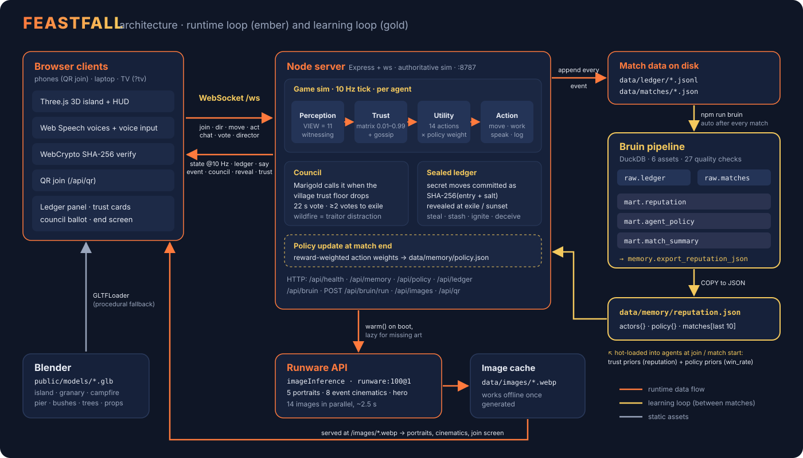

# FEASTFALL architecture



## Components

| Component | File | Role |
|---|---|---|
| HTTP + WebSocket server | `server/index.js` | Serves `public/`, the Runware image cache, the deck and docs. Hosts `/ws`, runs the 10 Hz loop, spawns the Bruin pipeline, exposes `/api/*`. |
| Game simulation | `server/game.js` | Authoritative world: resources, fires, agents, humans, council, ledger, sealed commitments, policy learning. |
| Runware client | `server/runware.js` | 14 prompts, parallel `warm()` at boot, lazy `generate()` for missing art, cache in `data/images/`. |
| Browser client | `public/main.js` | Three.js scene (Blender GLBs with a procedural fallback), HUD, Web Speech TTS and speech recognition, WebCrypto verification of reveals. |
| Memory pipeline | `bruin/feastfall_memory/` | 6 DuckDB SQL assets, 27 quality checks, export to `data/memory/reputation.json`. |
| Pipeline runner | `scripts/run-bruin.sh` | Runs from the project root, creates the git repo Bruin needs, validates the output JSON. |

## Runtime loop (every 100 ms)

1. `game.tick(dt)`: regrow bushes and trees, spread and burn fires, drain energy, move humans, and for each agent with no task run `decide()` then `act()`.
2. Broadcast a `state` snapshot to every socket.
3. Broadcast `res` (resources) at most every 0.5 s when something changed.
4. Send each player a `trust` message about 20% of ticks: what every agent currently thinks of them.

During a Council the clock stops, everyone walks to a seat around the campfire, and agents vote on their own timers between 2.5 and 11.5 s. After 22 s any missing agent votes are cast and the Council resolves.

## Agent decision (`Game.decide`)

Every candidate action gets `u = base × policy_weight × U(0.9, 1.1)`. The best one becomes the agent's task; the top three scores are kept. `accuse`, `council`, `ignite`, `steal`, `extinguish` and `gift` decisions are logged with those scores. `steal`, `stash` and `ignite` go through `sealedLog()` instead of `log()`.

## Ledger format

Each line of `data/ledger/match-<id>.jsonl`:

```json
{"match_id":"m_4e4134","t":81.4,"ts":"2026-11-23T…","actor":"juniper","actor_name":"Juniper","actor_type":"agent",
 "action":"accuse","target":"vex","amount":null,"reason":"trust in Vex is 0.31","utility":0.58,"x":3.2,"z":-1.7}
```

Sealed rows are persisted with `"sealed": true`. Over the socket, clients get only `{id, t, sealed, commitment}` until the reveal, which carries the full entry plus its salt. The browser checks `SHA-256(JSON.stringify(entry) + salt) === commitment`.

## Learning loop

```
match end ──► data/matches/<id>.json ──► (1.2 s) scripts/run-bruin.sh
                                             │
   raw.ledger, raw.matches ──► mart.reputation, mart.agent_policy, mart.match_summary
                                             │
                     memory.export_reputation_json ──► data/memory/reputation.json
                                             │
                        server loadMemory() ─┴─► game.setMemory()
```

- **Reputation → trust.** `addHuman()` seeds every agent's trust toward a returning player from `actors[name].reputation`, and picks a grudge or thank-you line from their steals and gifts.
- **Policy → weights.** `setMemory()` turns `policy[agent][action].win_rate` into a prior weight `clamp(0.8 + 0.4 · win_rate, 0.6, 1.4)` for actions with no reinforced weight yet.
- **Reinforcement.** `endMatch()` updates every used action's weight by `0.35 · reward · share_of_uses` plus a small bonus or penalty, clamped to `[0.5, 1.8]`, and writes `data/memory/policy.json`. The traitor's `steal` and `ignite` are excluded.

## Bruin assets

| Asset | Depends on | Output |
|---|---|---|
| `raw.ledger` | `data/ledger/*.jsonl` | One row per event, explicit schema, skips half-written lines |
| `raw.matches` | `data/matches/*.json` | One row per finished match, deduped on `match_id` |
| `mart.reputation` | `raw.ledger` | Per-actor counts and the clamped reputation score |
| `mart.agent_policy` | `raw.ledger`, `raw.matches` | Per (agent, action) count, mean utility, win rate |
| `mart.match_summary` | `raw.ledger`, `raw.matches` | Per-match outcome, resources, theft and accusation timing |
| `memory.export_reputation_json` | all three marts | `COPY` to `data/memory/reputation.json` |

DuckDB allows one writer at a time, so the server reads only the exported JSON and never opens `data/feastfall.duckdb`.

## Trust and secrecy boundaries

- The traitor's id is held on the server. Snapshots include a character's `role` only after it has been exiled.
- The stash location and amount are sent only in the `end` phase.
- Clients are untrusted input: names are sanitised, coordinates are clamped, chat is truncated to 140 characters, and director values are checked against allowed lists.
